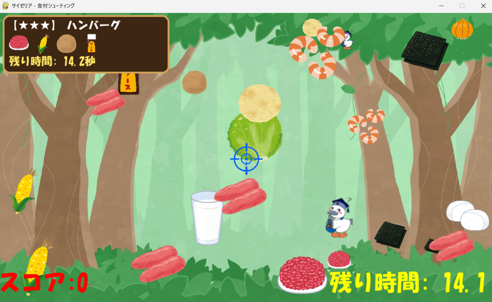

# サイゼリア

 
## 実行環境の必要条件
* python >= 3.10
* pygame >= 2.1

## ゲームの概要
* 食材を獲得して、あなただけのサイゼリアを作ろう！
* プレイヤーは照準を操作して空中を漂う食材を撃ち落とし、画面左上に表示されるレシピに必要な食材を集める。制限時間内に料理を完成させることでスコアを獲得し、たくさん完成させることでより豪華なサイゼリアメニューの完成を目指すシューティングゲームである。
* 参考URL：[サイゼリヤ](https://www.saizeriya.co.jp/)
* BGM：[Kamatamago (https://kamatamago.com)](https://kamatamago.com) 一部尺を編集して使用
* 背景画像：[OKUMONO(https://sozaino.site)](https://sozaino.site)
* 食材画像：[いらすとや(https://www.irasutoya.com)](https://www.irasutoya.com)

## ゲームの遊び方
* 矢印キーで照準を操作し、スぺスキーで射撃することで食材を獲得
* 画面左上に表示されたレシピを頼りに食材を狙う
* 30秒以内でできるだけ多くの料理を完成させて高いスコアを目指す

## ゲームの実装
### 共通基本機能
* 背景画像と照準の描画

### 分担追加機能
* 照準クラス作成（担当：山本）：照準クラス（Aiming）の作成。矢印キーによる移動機能、スペースキーでの狙撃処理、狙撃時の爆発エフェクト（explosion.gif）切り替え、およびMask判定を用いた食材（Food）との精密な当たり判定・削除処理の実装

* 食材生成（担当：竹中）：食材画像用意・画面内にランダム生成・浮遊。レシピのタイムアップまたは料理が完成すると新しい食材が表示される。レシピに表示された食材は必ず出現する。

* レシピ管理（担当：廣島）：レシピクラス作成(Recipe)・ランダムでレシピの表示。料理が時間内に完成したら次のレシピを表示。

* 正誤判定（担当：川辺）：撃ち落とした食材を管理し、お題のレシピの材料と一致するかを判定するために、Judgmentクラスを定義した。また、お題のレシピの材料がすべてそろい、料理が完成した場合は、難易度(☆の数)×100のスコアをスコア表に加算するようにした。
正誤判定を作成するにあたって必要なコードやクラスは仮で定義した。

* 画面遷移（担当：福田）：クリア画面、ゲームオーバー画面、スタート画面表示、最終スコア表示、マウスクリックによってスタート、次へ、リトライ、タイトルに戻る操作を行う機能

* タイマー・スコア（担当：鈴木）：制限時間表示、タイムアップ処理、スコア表示
残り時間の計測とタイムアップ処理pg.time.get_ticks()を用いてゲーム開始からの経過時間を計算し、全体の制限時間（30秒）から引くことで残り時間を実装した。時間が0以下になった際に自動でタイムアップとなる処理を実装した。画面右下にスコアと残り時間を表示させた。

## ToDo
### 実装できなかった、する予定だった、してみたい機能
* スコアを消費して、レシピのスキップや射程を一定時間広げる機能
* 正解食材を打った際に、エフェクトや効果音などの分かりやすい演出が入る機能
* タイムアップ前のカウントダウン効果音、スコア表示の色変え
* 食材が重なっている場合、両方に当たり半手がついてしまう問題の改善
* 完成した料理名の表示
* 間違った食材を打ち落とした際に減点する機能
* 特定のアイテムを打ち落とすことで、制限時間の延長や、照準の動きを一時的に早くする機能

### メモ
* スコア（必要食材） 変数名
* ☆辛味チキン（こうかとん）koukaton
* ☆☆たらこソースパスタ（たらこ、パスタ、のり）tarako,pasuta,nori
* ☆☆マルゲリータ(ピザ生地、モッツァレラ、とまと)kiji,cheese,tomato
* ☆☆☆小エビのサラダ　(えび、レタス、トマト、ドレッシング)ebi,retasu,tomato,dore
* ☆☆☆ハンバーグ（ひき肉、コーン、じゃがいも、ソース）hikiniku,corn,imo,sosu
* ☆☆☆☆ミラノ風ドリア（米、ホワイトソース、トマト、玉ねぎ）kome,Wsosu,tomato,tamanegi
* ☆☆☆☆若鳥のディアボラ（こうかとん、コーン、ソース、じゃがいも）koukaton,corn,sosu,imo

* ☆通りのスコアが加算される

